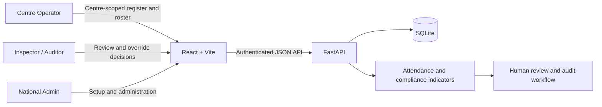

<div align="center">

# SACH
## Smart Attendance & Compliance Hub

**A role-aware monitoring and audit prototype for training-centre attendance and infrastructure compliance.**

**SIH Problem Statement 245 · Team Heisen-de-Bug**

</div>

---

SACH brings centre attendance workflows, infrastructure audit records, alerts, and review tools into one web application. It is designed to help authorized officials compare submitted information with available telemetry, investigate discrepancies, and preserve a traceable review process.

> **Prototype notice:** This repository is a working prototype, not a production government service. Live camera feeds require a separately started AI producer and a configured camera source. Dev1 reports centre-wide person counts; its local face matching is not linked to enrolled roster profiles or course attendance. Risk indicators are review signals, not findings of fraud.

## At a glance

- **National Admin:** centre, course-batch, roster, user, and system administration.
- **Inspector / Auditor:** centre monitoring, audit workflows, reports, attendance-register review, and unlock-request decisions.
- **Centre Operator:** a centre-scoped workspace for daily attendance, learner roster, monthly history, and register guidance.
- **Attendance integrity:** daily register submissions, a single edit during a 30-minute grace window, permanent locking, and an Inspector/Admin override workflow.
- **Auditable actions:** submissions, edits, and override decisions retain timestamps and actor details, with network metadata recorded for correlation.
- **Risk logic:** attendance gaps are compared with officially marked-present learners; enrolled learners already marked absent are excluded.

## How it fits together



### Attendance discrepancy

The attendance comparison uses the official **Marked Present** count as its baseline:

```text
gap = max(0, marked_present - camera_detected)
coverage = camera_detected / marked_present * 100
attendance_penalty = gap / marked_present * 100
```

If no learners were marked present, the ratio is not calculated. Registered learners marked absent do not add to the discrepancy or penalty.

The risk engine can use the rolling median of camera headcount samples over a ten-minute window. A brief drop is buffered; an alert is eligible only for a sustained discrepancy. This describes the backend telemetry/risk logic: it does **not** mean a live, course-specific camera feed is bundled with this repository.

## Technology

| Layer | Tools |
| --- | --- |
| Web client | React, Vite, React Router, Axios, Recharts, Lucide |
| API | FastAPI, Pydantic |
| Persistence | SQLAlchemy with SQLite |
| Tests | Python `unittest`, frontend production build, Oxlint |

## Run locally

### Prerequisites

- Python 3.10 or later
- Node.js compatible with Vite 8 and npm
- macOS, Linux, or Windows with equivalent shell commands

### 1. Clone the repository

```bash
git clone https://github.com/KananSangal/Project-S.A.C.H..git
cd Project-S.A.C.H.
```

### 2. Set up the backend

Create and activate a virtual environment, then install the backend requirements:

```bash
python3 -m venv .venv
source .venv/bin/activate
python -m pip install -r backend/requirements.txt
```

On Windows PowerShell, activate with `.venv\Scripts\Activate.ps1`.

On a new database, the backend seeds sample centre records. It does not seed course batches or learner rosters. Configure the first Admin account through environment variables; choose a password of at least 12 characters and keep it private:

```bash
export SACH_BOOTSTRAP_ADMIN_USERNAME="sach-admin"
read -s SACH_BOOTSTRAP_ADMIN_PASSWORD
export SACH_BOOTSTRAP_ADMIN_PASSWORD
```

In Windows PowerShell, you can set the same process-local variables without putting the password in shell history:

```powershell
$env:SACH_BOOTSTRAP_ADMIN_USERNAME = "sach-admin"
$securePassword = Read-Host "Admin password" -AsSecureString
$env:SACH_BOOTSTRAP_ADMIN_PASSWORD = [System.Net.NetworkCredential]::new("", $securePassword).Password
```

Do not save credentials in a script or commit them. A local secret manager is preferable for repeated use.

The API creates that Admin account when it initializes the database. To start the API:

```bash
cd backend
python -m uvicorn app.main:app --reload --host 127.0.0.1 --port 8000
```

Open the API documentation at [http://127.0.0.1:8000/docs](http://127.0.0.1:8000/docs).

#### Dev2 infrastructure detector

Infrastructure scans run Dev2's `inference_cli.py` in a subprocess so the Dev3 API can stay separate from the YOLO/PyTorch environment. By default, Dev3 expects the sibling `dev2` folder, its `.venv` Python interpreter, and `models/equipment_yolo11n_v2.pt`. If Dev2 is stored elsewhere, set `SACH_DEV2_ROOT` and `SACH_DEV2_PYTHON` in the backend environment before starting Uvicorn. A scan stores the original images, model-annotated images, per-view detections, confidence scores, and model/device metadata; unsupported centre equipment classes are explicitly excluded and force review.

#### Live camera producers

Start Dev1's `attendance_vision.py` first; it is the single camera capture process for the selected centre. Dev1 publishes the captured frames to the authenticated centre camera stream, then separately publishes its annotated attendance stream. Dev2's `infra_audit.py` subscribes to those same raw camera frames and runs its equipment detector on them; it no longer opens a second camera device. Both producers must use the same centre; set `SACH_CENTRE_ID` in both environments to avoid selecting different centres. Infrastructure Audit compares the centre-scoped camera IDs from both live streams and reports a mismatch rather than implying they share a source.

Set `SACH_AI_API_TOKEN`, or both `SACH_AI_USERNAME` and `SACH_AI_PASSWORD`, in each process's environment. Dev1's account must be authorized to submit attendance for its selected centre; Dev2's account must be an Admin or Official. Dev1 sends UTC attendance samples every two seconds. Dev2 sends transient telemetry to `/api/audit/live`; this does not create audit-history records or overwrite evidence-backed scan results. The server calculates live computer compliance from that centre's current equipment configuration.

Dev1 reads `SACH_CAMERA_SOURCE_<CENTRE_ID>` (for example, `SACH_CAMERA_SOURCE_DELHI_001`) or falls back to `SACH_CAMERA_SOURCE` and then camera index `0`. It reads `SACH_CAMERA_LABEL_<CENTRE_ID>` or `SACH_CAMERA_LABEL` for the non-secret camera ID displayed in both feeds. Use the same `SACH_BACKEND_URL` in both processes. Never put credentials in a camera URL or camera label sent to the UI. Browser WebSocket clients and camera producers authenticate with their existing bearer session in the initial WebSocket message; tokens are not placed in the URL.

The monitoring page shows the selected centre's Dev1 feed; Infrastructure Audit shows Dev2's equipment annotations over the same captured input. The monitoring page does not offer a classroom selector because no classroom-to-camera mapping exists yet. The displayed resolution comes from received frames; live FPS and bitrate are not claimed. Course/roster identity matching still requires an approved face-profile enrollment and camera mapping and is not represented as completed.

### 3. Set up the frontend

In a second terminal, from the repository root:

```bash
cd frontend
npm ci
npm run dev
```

Open the local Vite URL printed in the terminal (normally [http://127.0.0.1:5173](http://127.0.0.1:5173)). The current client expects the API at `http://127.0.0.1:8000/api`.

### 4. Configure the first centre workflow

1. Sign in with the Admin credentials configured above.
2. Open **Centres, Courses & Rosters** to register a centre if needed, create course batches, and add enrolled learners.
3. Open **Users & System Settings** to provision named user accounts and assign roles. Assign Centre Operators to a centre.
4. Sign in with the provisioned Operator account to submit and manage that centre's daily register.
5. Use **Centre Registers** as an Admin or Auditor to review submissions and handle override requests.

The seeded sample centres are not evidence of live camera telemetry. The WebSocket relay displays frames only when a camera producer is running for that centre; a centre with no recent producer is shown as waiting or stale. Course-level camera verification remains unavailable until a verified course-level feed is integrated.

## Role and security boundaries

| Role | Intended access |
| --- | --- |
| **Admin** | National administration, centre/course/roster setup, users, and system settings |
| **Auditor / Inspector** | Monitoring, audits, reports, centre-register review, and override decisions |
| **Centre Operator** | Assigned-centre attendance, roster, and history only |

The role selector in the Admin interface is a **UI preview**, not an authentication or authorization grant. API permissions are checked server-side. Operator routes are scoped to the operator's assigned centre; they cannot use the national dashboard, alerts inbox, or Inspector/Admin endpoints.

### Security notes

- Do not commit passwords, access tokens, private keys, or `.env` files. The repository `.gitignore` excludes them and local database files.
- Keep bootstrap credentials in your shell environment or a properly secured secret manager. Never publish them in source, screenshots, issues, or documentation.
- Passwords are hashed by the backend; authenticated sessions use bearer tokens with a limited lifetime.
- Roster APIs expose face-profile identifiers/status metadata only; they do not store raw face images or biometric templates.
- The recorded IP/User-Agent-derived network signature is audit correlation metadata, not proof of physical location.
- The frontend currently uses a localhost API URL. Configure deployment-specific origins and HTTPS before exposing this prototype beyond a trusted local environment.

## API overview

All application endpoints are under `/api`. Authenticate through the login endpoint and send the returned bearer token for protected requests.

| Area | Example routes | Purpose |
| --- | --- | --- |
| Authentication | `POST /api/auth/login`, `GET /api/auth/me` | Sign in and inspect the current account |
| Administration | `POST /api/admin/centres`, `POST /api/admin/courses` | Register centres and course batches |
| Rosters | `POST /api/admin/courses/{id}/students`, `GET /api/admin/courses/{id}/students` | Manage course learners |
| Operator workspace | `GET /api/operator/portal`, `GET /api/operator/attendance-registers` | Load centre-scoped operator data |
| Attendance registers | `POST /api/operator/attendance-registers`, `PUT /api/operator/attendance-registers/{id}` | Submit or make the permitted edit |
| Override workflow | `POST /api/operator/attendance-registers/{id}/override-requests`, `GET /api/inspector/override-requests` | Request and review a locked-register override |
| Monitoring | `GET /api/dashboard/stats`, `GET /api/alerts` | Authorized national monitoring data |
| Reports | `GET /api/reports/export.csv?report_type=attendance` | Export the selected report |

For request/response schemas and the complete route list, use the local interactive API documentation at `/docs`.

## Development checks

From the repository root:

```bash
cd backend
python -m unittest discover -s tests -p 'test_api.py'
cd ../frontend
npm run lint
npm run build
```

The lint command may report existing warnings; resolve new errors introduced by your changes before merging.

## Current prototype boundaries

- Attendance and infrastructure WebSocket relay endpoints are included, but no physical CCTV source is bundled; run a camera producer for each centre that needs a live feed.
- New infrastructure audits use Dev2 YOLO. Historical records marked `SIMULATED`, and any unavailable/stale live feed, are not live evidence.
- Face matching and verified course-level camera feeds are not included.
- SQLite is suitable for local development and demonstrations, not a multi-instance production deployment.
- Production use needs deployment-grade secret management, HTTPS, database operations and backups, monitoring, privacy/biometric governance, and security review.

## Contributing

1. Create a focused branch for your change.
2. Keep credentials and local data out of Git.
3. Run the backend tests, frontend lint, and production build.
4. Describe prototype limitations and any user-visible behavior changes in your pull request.

---

<div align="center">

**SACH · Making compliance easier to review, explain, and audit.**

</div>
